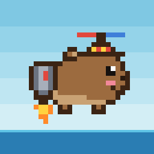
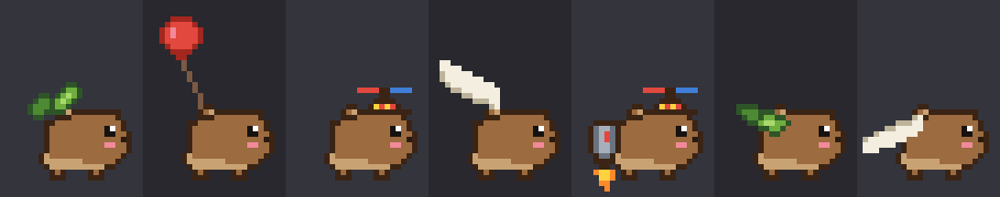
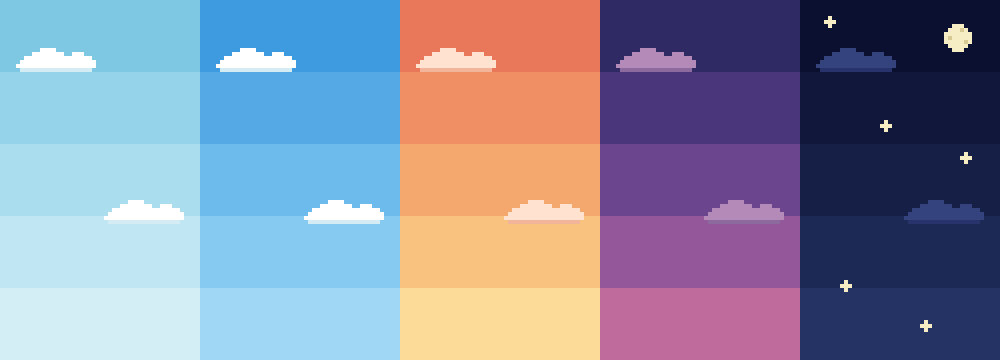
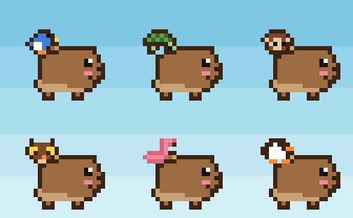
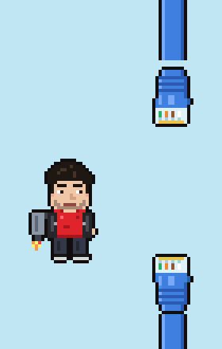
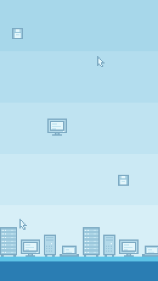

<div align="center">



# Kapibara Uçuşu

**Sinir bozucu ama sakinleştirici bir piksel art uçuş oyunu.**

Jetpack'li, pervaneli şapkalı bir kapibara bambuların arasından süzülür, portakal toplar,
sırtına arkadaş alır… ve çarptığında hiç telaşlanmadan denize düşüp sırtüstü yüzer.

Expo · React Native · Skia · Reanimated

</div>

---

## Oyun

Ekrana dokundukça kapibara yükselir, bırakınca düşer. Bambu kamışlarının arasındaki boşluktan
geçtikçe puan kazanırsın. Kapibaranın yüz ifadesi hiç değişmez; yalnızca portakal yerken minicik
gülümser.

### Skorla evrimleşen kıyafetler

Her oyun yaprak kanatla başlar. Skor arttıkça kapibara yeni bir moda geçer; her modun uçuş hissi
farklıdır ve gökyüzü sabahtan geceye döner.



| Skor | Mod | His |
|---:|---|---|
| 0 | 🍃 Yaprak kanat | hafif süzülür, zayıf zıplar |
| 25 | 🎈 Balon | çok yavaş düşer, tembel tepki verir |
| 75 | 🚁 Pervaneli şapka | dengeli |
| 150 | 🪶 Kuş kanatları | çevik |
| 300 | 🚀 Jetpack + şapka | güçlü itiş |



### Yolcular: oyunun imzası

Yolda bekleyen hayvanların içinden geçince kapibaranın sırtına binerler ve üst üste yığılırlar.
Her yolcu puan çarpanını artırır ama kapibarayı ağırlaştırır. Her birinin bir yeteneği var.
Her gün de üç nadir yolcudan biri ortaya çıkar.



| Yolcu | Yetenek |
|---|---|
| 🐦 Kuş | hafif; itişi güçlendirir |
| 🐢 Kaplumbağa | ağır; bir çarpmayı kabuğuyla karşılar |
| 🐒 Maymun | portakalları uzaktan toplar |
| 🦉 Baykuş *(nadir)* | sırttayken kapibara uykulanmaz |
| 🦩 Flamingo *(nadir)* | çarpanda iki yolcu sayılır |
| 🐧 Minik Penguen *(nadir)* | rüzgârdan etkilenmez |

### Devam mı, bırak mı?

- **Yolcu durakları:** Yolcuların getirdiği bonus önce "sırtta" birikir. Kıyıdaki bayraklı
  iskeleye değersen yolcular iner ve bonus kasaya girer. Değmezsen çarpan büyür, ama çarparsan
  sırttaki bonus kaybolur.
- **Rüzgâr:** Bazı bambuların çevresinde yukarı ya da aşağı rüzgâr eser. Bambu yaprakları
  rüzgârın yönüne savrulur.
- **Esneme:** Uzun süre portakal yemeyen kapibara uykulanır: gözleri kapanır, esner, kontrolü
  ağırlaşır. Bir portakal onu ayıltır.

### Burak Uçuyor modu

Aynı motor, bambaşka bir dünya: CAT6 kabloların arasından uç, RAM, SSD, CPU ve GPU topla.
Her türden bir parça toplayınca **kasa** tamamlanır, bonus puan ve konfeti gelir.

<p>
  
  
</p>

### Daha fazlası

- 📔 **Arkadaş defteri:** Tanıştığın her hayvan için polaroid tarzında bir anı fotoğrafı.
- 📸 **Rekor kartı:** Rekor kırınca sırtındaki yolcularla birlikte paylaşılabilir bir kart.
- 🏆 Her modun ayrı rekoru, 🔊 ses ve 📳 titreşim (menüden kapatılabilir).

## Çalıştırma

Gerekenler: [Node.js](https://nodejs.org) ve telefonda [Expo Go](https://expo.dev/go).

```bash
git clone https://github.com/elifisilbesgur/kapibara-ucusu-oyun.git
cd kapibara-ucusu-oyun
npm install
npx expo start
```

Terminalde çıkan QR kodunu telefonundaki Expo Go ile tara.

> Telefon sessiz moddaysa oyun sesleri çalmaz (bilerek böyle ayarlandı).

## Nasıl yapıldı?

| | |
|---|---|
| Uygulama | [Expo](https://expo.dev) (SDK 57), React Native, TypeScript, [Expo Router](https://docs.expo.dev/router/introduction/) |
| Çizim | [React Native Skia](https://shopify.github.io/react-native-skia/) |
| Oyun döngüsü | [Reanimated](https://docs.swmansion.com/react-native-reanimated/) `useFrameCallback`, UI thread'de çalışan worklet'ler |
| Dokunma | React Native Gesture Handler |
| Kalıcı kayıt | zustand + AsyncStorage |
| Ses ve his | expo-audio, expo-haptics |

Birkaç ilginç ayrıntı:

- **Piksel art koddan çiziliyor.** Kapibara, yolcular, bambular ve gökyüzü `src/art/` altında
  metin ızgaraları olarak duruyor (her harf bir renk). `PixelSprite` bileşeni bunları Skia'da renk
  başına tek bir şekle çeviriyor.
- **Sesler sentezleniyor.** Bütün ses efektleri `scripts/make-sounds.py` ile kare dalga ve
  gürültüden üretiliyor; hazır ses dosyası yok.
- **İkonlar da öyle.** `scripts/make-icons.py` uygulama ikonunu ve açılış ekranını oyunun kendi
  çizimlerinden üretiyor.
- **Tek motor, iki mod.** Fizik ve kurallar `src/game/` altında, React'ten bağımsız. Her mod
  (`src/modes/`) yalnızca bir yapılandırma: kurallar (sayılar) ve görünüm (bileşenler).

```
src/
  app/         ekranlar: ana menü, oyun, arkadaş defteri
  game/        fizik ve kurallar (UI thread'de çalışan worklet'ler)
  modes/       Kapibara ve Burak Uçuyor yapılandırmaları
  art/         piksel çizimler (metin ızgaraları) ve PNG tanımları
  components/  oyuncular, engeller, eşyalar, arka plan, HUD, menüler
  store/       kalıcı durum (portakal, rekorlar, defter, ayarlar)
  feedback/    ses ve titreşim
scripts/       ses ve ikon üreticiler
assets/        Burak Uçuyor görselleri, sesler, ikonlar
```

Geliştirme notları, mimari kurallar ve adım adım geçmiş: [CLAUDE.md](CLAUDE.md)

## Geliştirme

```bash
npx tsc --noEmit                 # tip kontrolü
npx expo lint                    # lint
python3 scripts/make-sounds.py   # ses efektlerini yeniden üret
python3 scripts/make-icons.py    # ikon ve açılış görsellerini yeniden üret
```

## Lisans

[MIT](LICENSE)

> Not: "Flappy Bird" türü bir mekanik, ama ad, karakterler ve bütün görseller özgündür.
